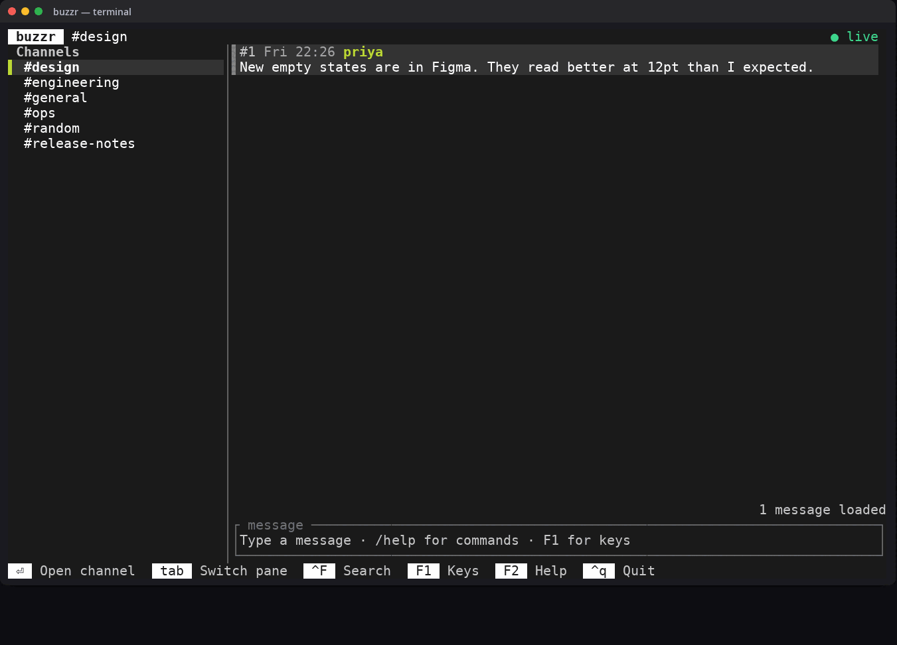
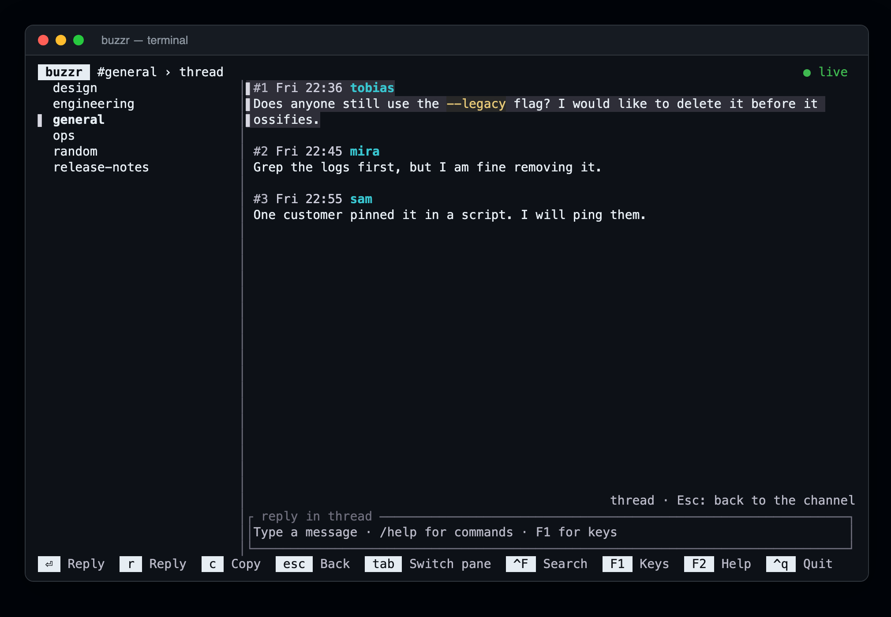
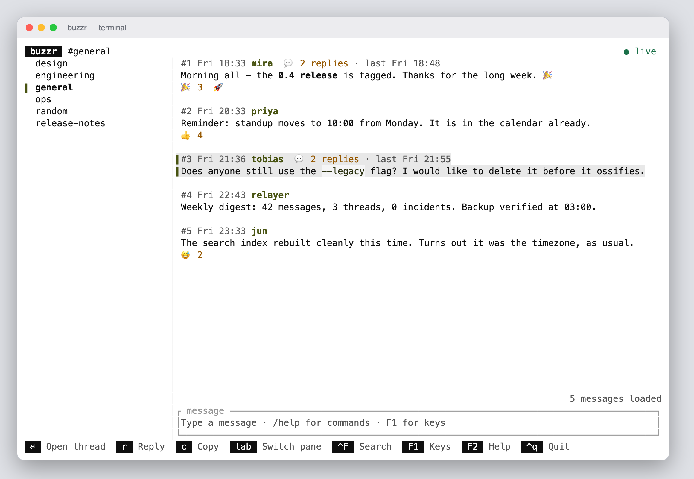

<h1 align="center">buzzr</h1>

<p align="center">
  A fast, keyboard-driven terminal client for <a href="https://github.com/block/buzz">Buzz</a>,
  the Nostr-based chat for people and agents.<br>
  One static binary. Live push, not polling. Real typing indicators.
</p>

<p align="center">
  <a href="https://github.com/buzzzr/buzzr/actions/workflows/ci.yml"></a>
  <a href="LICENSE"></a>
  
</p>

<p align="center">
  
</p>

> The screenshots and the recording in this README show a scripted demo community, not real conversations.

## Why buzzr

- **It talks to the relay directly.** No bridge, no helper daemon, no polling loop: buzzr opens a WebSocket and the screen updates the
  moment something happens.
- **Built for the terminal.** Everything is a key or a click, it works over SSH and inside tmux, and it starts instantly.
- **Careful with your key.** The private key is sealed at rest with scrypt and AES-256-GCM by default, never appears on a command
  line, and never reaches the logs or the screen.
- **Small and boring on purpose.** One crate and one binary, nothing else to install. Extensions run as separate processes, so the core stays small.

## Features

- **Channels and DMs** with unread counts, in sections: Solo chats, Channels (private and open) and DMs. DMs are labelled with the other
  person; start one with `/dm name`, or from search. An open channel is marked `#` and a private one `*`.
- **Unread that survives a restart.** The last-read position is saved per channel and per thread, so the badges are right again
  next time and a `new messages` line shows where you left off.
- **Threads.** A channel shows top-level messages only, as the Buzz app does, each with its reply count and the time of the last reply;
  a thread with replies since you last opened it shows `● 2 new`. Enter opens a thread (and reads it), Esc returns to the same place.
- **Live.** New messages, edits, deletions, reactions, reply counts and `Bob is typing…` arrive as they happen. If the connection
  drops, buzzr reconnects and reloads.
- **Reads like a chat.** Markdown (bold, italic, lists, code, quotes, headings), clickable links, reactions, and edited messages say so.
- **Keeps your place.** New messages never move the view unless you were at the bottom, and older history loads above without a jump.
- **Write, edit, delete.** A multi-line input with bracketed paste and `@name` mentions. Edit or delete your own messages with `e` and `d`.
- **Search everything.** Ctrl+F searches channel names, people and every message you can read, with full text from the relay. Enter on a
  person opens the DM you already have with them, or starts a new one.
- **Create channels** from the input with `/new`.
- **People and profiles.** `/whois name` shows a short card (name, npub, what they wrote about themselves); `/dm name` opens your DM with
  someone or starts a new one. Both take a name from a channel or an npub.
- **Plugins.** Add your own `/commands`, status items, badges and panels from any language. See [PLUGIN.md](PLUGIN.md).
- **Themes.** The default `buzz-dark` uses the dark palette of the Buzz desktop app. `BUZZR_THEME=dark` keeps your terminal's own background, `BUZZR_THEME=buzz-light` is the desktop app's light palette, and `BUZZR_THEME=light` is for a light terminal. `BUZZR_THEME=high-contrast` is black-on-white at WCAG AAA (7:1), and `NO_COLOR` or `TERM=dumb` turns colour off entirely.
- **Read-only mode** (`--read-only`) for identities you should not speak for.

<p align="center">
  
</p>

## Install

**Homebrew** (tested on macOS; the formula also lists the Linux binaries, untested):

```bash
brew install buzzzr/buzzr/buzzr
```

Upgrade with `brew update && brew upgrade buzzr`.

**A prebuilt binary:** download the archive for your system from the [latest release](https://github.com/buzzzr/buzzr/releases/latest)
(macOS and Linux, arm64 and x86_64; the Linux ones are static), check it against `SHA256SUMS`, and put `buzzr` somewhere on your `PATH`.

**With cargo** (Rust 1.88 or newer; not on crates.io yet):

```bash
cargo install --git https://github.com/buzzzr/buzzr
```

**From source:**

```bash
git clone https://github.com/buzzzr/buzzr
cd buzzr
./build.sh release        # optimised binary at dist/buzzr
```

`build.sh` uses `cargo` if it is installed and otherwise a Rust container, which produces a static musl binary. See
[Build](#build) for details.

## Quick start

```bash
buzzr
```

The first time, buzzr asks for your relay address and private key, and how to keep the key. After that it opens straight into your channels.
Press **F1** for the keys and **F2** for the commands. Press **Tab** to move between the channel list, the messages and the input.

The default colour scheme is `buzz-dark`; set `BUZZR_THEME=buzz-light` for the light one:

<p align="center">
  
</p>

## First run

If buzzr has no relay or key yet, it asks:

1. **The relay address**, for example `wss://chat.example.com` (a bare host gets `wss://`). Saved in `~/.config/buzzr/config.json`.
2. **Your private key** (hex or `nsec1...`; hidden as you type). buzzr shows the public key it belongs to so you can check it is yours.
3. **How to keep the key:**
   - **Protected by a password** (the default): `key.enc`, sealed with scrypt (512 MiB, a couple of seconds per guess) and
     AES-256-GCM. You type the password each time buzzr starts.
   - **Without a password**: `key`, a plain file readable only by you (mode 600, directory 700). buzzr starts straight away, but anyone
     who can read that file or a backup of it can act as you. buzzr refuses the file if other users can read it.
   - **Not stored**: buzzr asks for the key every time.

Everything is in `~/.config/buzzr` (`$XDG_CONFIG_HOME/buzzr`, or `$BUZZR_CONFIG_DIR`). `buzzr --setup` asks again and replaces the old
choice; `buzzr --forget-key` deletes the saved key. `--relay URL` or `BUZZ_RELAY_URL`, and `BUZZ_PRIVATE_KEY`, override the saved
values and skip the questions (for scripts and containers; the key is never accepted on the command line).

## Details

The full behaviour, for when the feature list above is not enough.

- **Channels and DMs** on the left (DMs are labelled with the other person, `✉ name`), with unread counts. An open channel is
  marked `#` and a private (restricted) one `*`; DMs get no marker. The selected channel has a full-width grey tint and a bar on
  the left, like the selected message; the bar is the accent colour while the list has focus and grey when it does not, so the accent
  marks where the focus is. The bar sits on the channel on screen; while the list has focus it follows the cursor, and leaving the
  list without opening a channel puts it back. The keyboard starts on the channel list, so Up/Down and Enter work as soon as buzzr opens.
  `/dm name` opens the DM you already have with someone, or starts a new one; a name from a channel or an npub both work.
- **Unread that survives a restart:** the last-read position per channel and per thread lives in
  `~/.config/buzzr/read-state.json`, so it is there again next time (each channel's count is asked of the relay on startup)
  and a `new messages` line marks where the unseen ones begin. Opening a channel marks it read; `/read` does it again and
  `/read all` clears every channel and its threads. `u` on a message goes the other way: it marks the channel unread from
  that message, so the badge and the `new messages` line come back and the position is written down.
- **A channel shows only its top-level messages**, as the Buzz app does, each with `💬 3 replies · last Thu 13:33` when it has a
  thread. The relay supplies the counts and says whether older messages exist.
- **Threads:** Enter or a click opens one, Esc returns to the same place. Opening a thread reads its replies, so a thread with
  replies since you last looked at it shows `● 2 new` after its reply count. `r` replies in the thread of the selected message.
- **Live:** new messages, edits, deletions, reactions, reply counts and typing indicators arrive over a WebSocket as they happen
  (`Bob is typing…`), and the header shows the connection state. If the connection drops it reconnects and reloads.
- **Reads like a chat:** Markdown (bold, italic, lists, code, quotes, headings), bare URLs become links, reactions are shown,
  edited messages say so. A blank line separates messages and the selected one has a grey tint and a bar on the left.
- **Keeps your place:** new messages never move the view unless you were at the bottom; older messages load above without a jump
  (Up at the top, Ctrl+O or `/more`).
- **Links:** a click on a link copies its URL to your clipboard (terminal clipboard sequence, see below). `c` copies the selected
  message.
- **Writing:** a multi-line box that grows; Enter sends. Alt+Enter and Ctrl+J add a line in every terminal, Shift+Enter in the ones
  that report it (`kitty`, `foot`, `WezTerm`, `Ghostty`, `iTerm2`) — the footer names the key that works where you are;
  bracketed paste; `@name` mentions members. Word and line editing keys (Ctrl+W or Alt+Backspace deletes the word before the
  cursor).
- **Edit and delete your own messages:** select one and press `e` (it loads into the input; Enter saves, Esc cancels) or `d` (asks
  `y` to confirm). Others see edits and deletions live. `/edit N` and `/delete N` do the same by number.
- **Search everything:** Ctrl+F (or `/search words`) searches channel names (instantly), people you have seen (from their profiles) and
  every message you can read (full text, from the relay); Enter opens the result — a message or channel in its channel or thread, a
  person in the DM with them (starting one if there is none).
- **New channels:** `/new [private] name [description]` creates one and opens it.
- **People:** `/whois name` shows a short card for someone — their name, npub and about line, filled in as the relay answers. `/dm name`
  and `/whois name` take a display name from a channel, or a key (`npub1…`, `nostr:` URI or hex); an ambiguous or unknown name is
  reported rather than guessed.
- **Your typing shows:** others see `<your name> is typing…` while you write (once every three seconds; not for `/commands` or
  edits). `--no-typing` turns it off.
- **Help on screen:** F1 lists the keys, F2 the commands. Esc closes a panel first, then cancels a reply, then leaves a thread;
  after that it steps back a pane at a time — from the input to the message list, and from the message list to the channel list.
- **Plugins:** a plugin is a separate process (in any language) that adds `/commands`, a status item, header badges, per-channel and
  per-message marks, and panels; buzzr hot-reloads it when its files change. Put a folder with a `plugin.json` in
  `~/.config/buzzr/plugins` (or point `--plugins-dir`/`BUZZR_PLUGINS_DIR` elsewhere). `/plugins` lists what loaded, and
  `buzzr plugins list|enable|disable` works from the shell. `--no-plugins` (or `BUZZR_SAFE_MODE=1`) turns the whole system off. See
  [PLUGIN.md](PLUGIN.md); a tiny example is in `examples/plugins/hello`.
- **Upgrading:** `/update` in the input says how to upgrade this copy, worked out from where the binary lives — `brew update &&
  brew upgrade buzzr` for a Homebrew install, `cargo install --force --git https://github.com/buzzzr/buzzr` for a
  `cargo install`, or the release page otherwise.
  Nothing is downloaded or changed. Once a day buzzr also asks GitHub's release feed whether a newer release exists; when there is
  one the status line says so (`buzzr 0.2.0 available · /update`) and the same upgrade line is printed after you quit.
  `BUZZR_NO_UPDATE_CHECK=1` turns the check off.

### Keys

| | |
|---|---|
| Tab / Shift+Tab | switch between channels, messages and the input |
| Up / Down | select a channel or message (Up at the top of a channel loads older messages) |
| Enter | open the channel / open the thread (which reads it) / send |
| r, c, u, e, d | reply in the thread, copy, mark unread, edit, delete the selected message (e and d: yours only) |
| Ctrl+F | search channels, people and messages |
| Esc | close a panel, cancel a reply, leave a thread, then step back to the channel list |
| F1, F2 | keys, help |
| Ctrl+R, Ctrl+O | reload, load older |
| Ctrl+Q, Ctrl+C | quit |

Commands in the input (N is the number shown as `#N`): `/r N text`, `/t N`, `/c`, `/copy N`, `/edit N`, `/delete N`, `/search text`, `/whois NAME`, `/dm NAME`, `/new [private] name [about]`, `/plugins`, `/update`, `/read [all]`, `/more`, `/refresh`, `/help`, `/q`.

## Clipboard

`c` and link clicks use the terminal's clipboard escape sequence (OSC 52), which works over SSH when the terminal allows it:
iTerm2 ("Applications in terminal may access clipboard"), kitty, WezTerm, Ghostty, Windows Terminal. In tmux add
`set -g set-clipboard on`. macOS Terminal.app ignores it. Run buzzr on your own machine (not over SSH) and links are opened in the
browser as well.

## Options

`--relay URL` (default `$BUZZ_RELAY_URL`, else the saved relay), `--setup`, `--forget-key`, `--read-only` (never send), `--no-typing`
(do not announce typing), `--no-mouse` (leave the mouse to the terminal), `--no-plugins` (start without plugins), `--plugins-dir DIR`
(where plugins live), `--selftest` (below). Environment: `BUZZR_TZ` for the display
time zone (default: the computer's), `BUZZR_THEME` (`buzz-dark`, `buzz-light`, `high-contrast`, `dark`, `light`), `BUZZR_CONFIG_DIR`, `BUZZR_PLUGINS_DIR`,
`BUZZR_SAFE_MODE=1` (same as `--no-plugins`), `BUZZR_NO_UPDATE_CHECK=1` (skip the once-a-day release check), `BUZZR_SCRYPT_LOG_N` (cost of a new
key file, 10-20, default 19).

## Build

You need Rust 1.88 or newer (or Docker). `build.sh` uses `cargo` if it is installed, otherwise a Rust container; see the top of the
script (it can also build on another machine over ssh).

```bash
./build.sh test        # unit tests
./build.sh release     # optimised binary at dist/buzzr
cargo install --path . # or install with cargo
```
The Buzz crates (`buzz-core`, `buzz-sdk`, `buzz-ws-client`) are pulled from the Buzz repository at the commit pinned in `Cargo.toml`;
the relay you connect to should be recent enough to speak the same protocol.

## Checking it against a relay

`buzzr --selftest [--listen 12] [--probe-typing CHANNEL]` is a read-only check for a machine with an identity but no terminal (for
example a container; set `BUZZ_RELAY_URL` and `BUZZ_PRIVATE_KEY`): it authenticates, lists channels, loads a channel window and a thread, and listens on the live connection.
`--probe-search TEXT` runs a full-text search. `--probe-write` is the one check that writes: it creates a **private throwaway channel** (only the
testing identity can see it), posts, edits and deletes a message in it, then deletes the channel. `--probe-typing` publishes one typing indicator (ephemeral, never stored) through the same signed HTTP path chat messages use and
expects it to come back live.

## Status and limitations

buzzr is young (0.1) and under active development. It works against real Buzz relays, but expect rough edges. Not done yet:
adding reactions, attachments and images (shown as links only), joining or leaving channels.

If something is missing that you need, please [open an issue](https://github.com/buzzzr/buzzr/issues).

## Contributing

Bug reports, ideas and pull requests are welcome. Read [CONTRIBUTING.md](CONTRIBUTING.md) first, then [ARCHITECTURE.md](ARCHITECTURE.md) for
how the code fits together. A change is done when `./build.sh test` is green and the build has no warnings. To report a security issue,
please do not open a public issue; see [SECURITY.md](SECURITY.md).

## Acknowledgements

buzzr builds on the [Buzz](https://github.com/block/buzz) crates (`buzz-core`, `buzz-sdk`, `buzz-ws-client`), [ratatui](https://ratatui.rs) and
[Nostr](https://nostr.com). It is an independent community project and is not affiliated with or endorsed by the Buzz team.

## License

MIT, see [LICENSE](LICENSE). Contributions: see [CONTRIBUTING.md](CONTRIBUTING.md).
